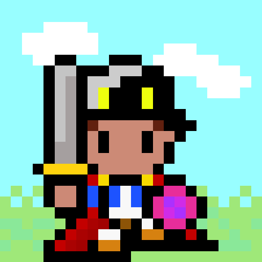
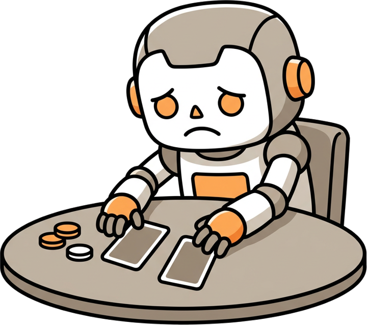
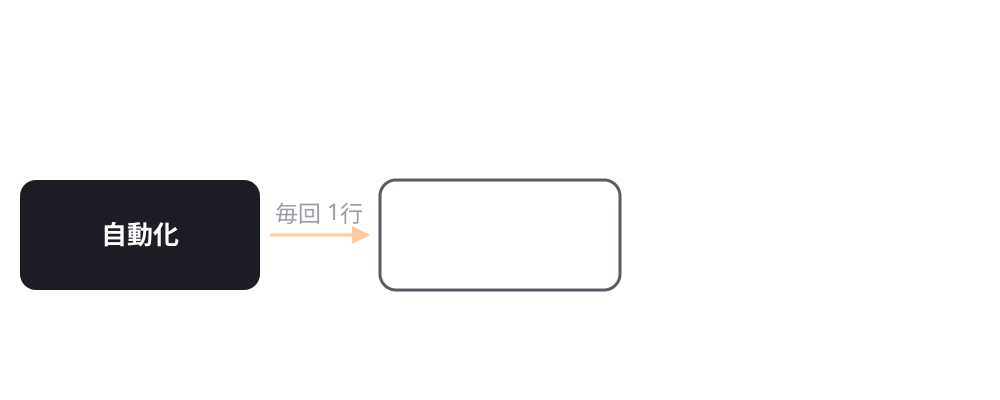
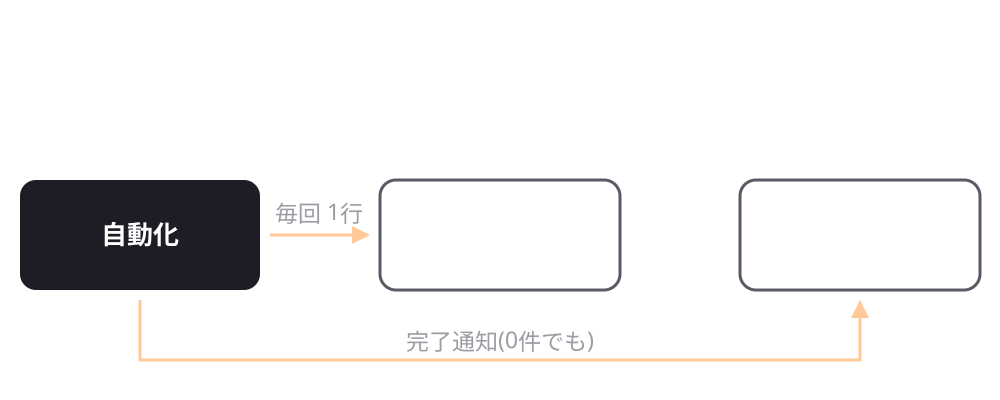
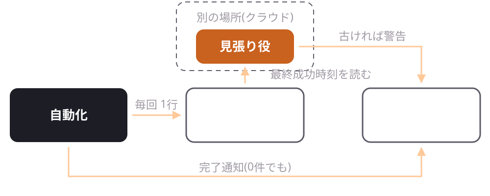
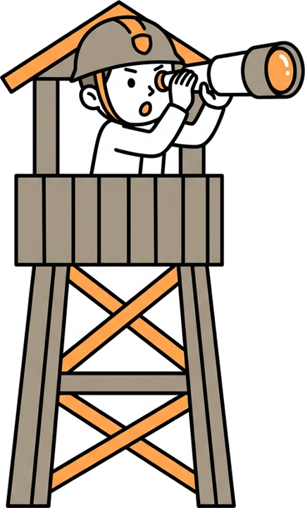
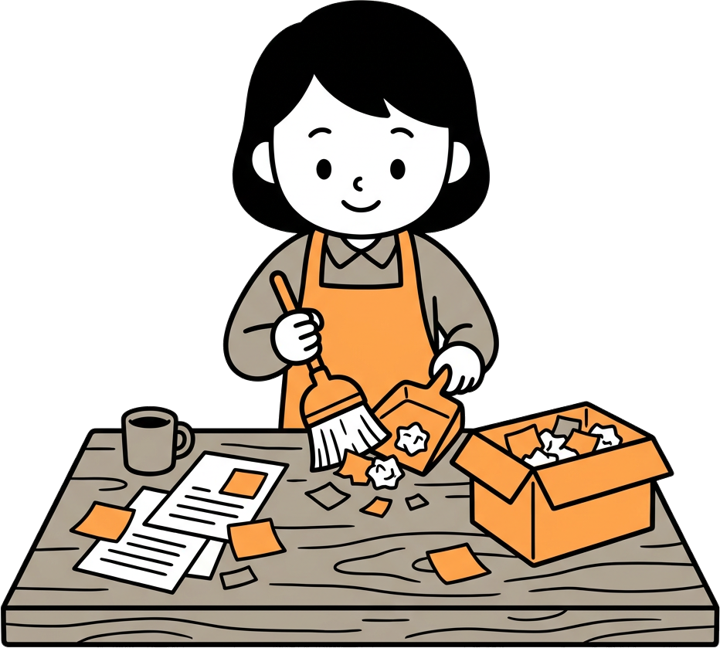

<style>
section { font-family: 'Zen Maru Gothic', 'BIZ UDPGothic', 'Yu Gothic UI', 'Yu Gothic', 'Hiragino Maru Gothic ProN', sans-serif; }
/* 配色: テーマ既定のシアンを、暖色(橙)に差し替える。黒との明度比は slide-design-dark の目安に合わせた
   見出し・線 #ffa94d (11.0) / 帯 #e8772e (7.1) / 図の主役の箱 #c9611f (5.2) / 強調 #ffe45c (16.5) */
h1, h2 { color: #ffa94d; }
h3 { color: #ffc98a; }
em { color: #ffd9b0; }
strong { color: #ffe45c !important; }
a { color: #ffa94d; }
section.top { background: linear-gradient(to bottom, #000000 60%, #e8772e 60%); }
section.crosshead h1 { color: #ffffff; }
/* 表は地を塗らず罫だけ(slide-design-dark の確定デザイン) */
table { display:table !important; width:100%; border-collapse:collapse !important; background:transparent !important; border:none !important; font-size:24pt; }
table thead, table tbody, table tr { background:transparent !important; border:none !important; }
table th { background:transparent !important; color:#a09aa4 !important; font-weight:600; font-size:18pt; letter-spacing:.06em;
  text-align:left; padding:0 .7em .55em; border:none !important; border-bottom:1px solid #3a3640 !important; }
table td { background:transparent !important; color:#e9e6ec !important; padding:.5em .7em; line-height:1.4; white-space:nowrap;
  border:none !important; border-bottom:1px solid #221f28 !important; vertical-align:top; }
table tr:last-child td { border-bottom:none !important; }
table td:first-child { color:#ffffff !important; font-weight:700; }
table td.key { color:#ffa94d !important; font-weight:700; }
/* コードは半透明パネル */
.win { position:relative; border-radius:18px; margin:8px 0 28px; padding:22px 0 4px; overflow:hidden;
  background:linear-gradient(165deg, rgba(255,255,255,.10) 0%, rgba(255,255,255,.045) 100%);
  border:1px solid rgba(255,255,255,.14); box-shadow:0 18px 44px rgba(0,0,0,.45); }
.win::before { content:""; position:absolute; left:0; right:0; top:0; height:3px;
  background:linear-gradient(90deg, #e8772e 0%, #ffa94d 45%, rgba(255,169,77,0) 100%); }
.win pre { background:transparent !important; box-shadow:none; margin:0; padding:0 28px 16px; font-size:21.5pt; line-height:1.3; }
.win pre code { color:#f2f1f5; background:transparent; }
.win pre .hljs-subst { color:#f2f1f5; }  /* テンプレート文字列の ${} が沈むのを防ぐ */
.win + .win { margin-top:44px; }  /* パネルを2つ並べるときの間隔(36px以上) */
.win.sm { margin:0 0 42px; padding:6px 0 0; } .win.sm + .win.sm { margin-top:0; }
.win.sm pre { font-size:14pt; line-height:1.15; padding:0 22px 6px; }
section.code h1 { margin-bottom:.4em; }  /* 3ブロックを1枚に収めるため意図的に小さく */
img[alt~="center"] { display:block; margin:40px auto 44px; }
/* 挿絵。右下の空きに置く。bottom はスライドごとに本文下端からの空きを見て決める */
.ill { position:absolute; right:118px; bottom:90px; width:290px; }
/* 自己紹介: 右上にアイコン、右下に X の QR。本文は左 760px に収める */
.avatar { position:absolute; right:118px; top:72px; width:265px; border-radius:32px; image-rendering:pixelated; }
.qr { position:absolute; right:180px; bottom:64px; width:140px; border-radius:12px; }
/* 表紙: 公開リポジトリの PDF ダウンロード用 QR。帯の右端に置く */
.qr-pdf { position:absolute; right:80px; bottom:54px; width:180px; border-radius:12px; z-index:2; }
.qr-pdf-label { position:absolute; right:80px; bottom:22px; width:180px; text-align:center; font-size:14pt !important; color:#fff !important; font-weight:700; z-index:2; margin:0 !important; padding:0 !important; }  /* アイコンと中心(x=1030)を揃える */
section.intro ul { max-width: 720px; }
.handle { font-size:20pt; color:#a09aa4; font-weight:normal; margin-left:.6em; }
.ill.tall { width:200px; bottom:80px; }
.ill.wide { width:330px; bottom:110px; }
</style>

<!-- _class: top -->
<!-- _paginate: false -->

# 作る前に、<br>4つだけ決める。

<br><br>

syou


<div class="qr-pdf-label">スライド PDF</div>

<!-- QR は公開リポジトリの deck.pdf(raw)への直リンク。高知AI活用キャンプ2026 午後の部。総理の話(場所×主体)の応用編。 -->

---

<!-- _class: intro -->

# syou です <span class="handle">@nft_syou</span>

- Web歴12年。請求書サービス作ってました
- NFT・ブロックチェーンの現場を4年
- 2025年からAIへ。音声配信を丸ごと自動化




<!-- 午前10:35に講師紹介(1〜2分)が済んでいるので、ここは30秒。音声配信を自作アプリで自動化している、の一言で本題へ。飛ばしてもよい。 -->

---

<!-- _class: crosshead -->

# ここまでの総理の話、ついてこれました？

<!-- 総理の分類(ローカル/クラウド × AI/プログラム/ハイブリッド)を一言だけ受ける。繰り返さない。 -->

---

<!-- _class: crosshead -->

# …で、自分の仕事はどれから？

---

# 今日の例題はこの2つ！

- 毎日ニュースをメールで送る
- ダウンロードフォルダを整理する

このあとの制作時間で、すぐ手元で試せます

---

# 作る前に決めるのは、この4つ

1. どこで動かす？
2. 誰がやる？
3. どう見張る？
4. どう引き継ぐ？

1と2は総理の「まず2つ」。3と4を足します

<!-- 総理の p10 の図「自動化を考えるときは、まず2つを考える: ①どこで動かすのか ②どの部分をAIに任せるのか」を受けて、そこに「見張る」「引き継ぐ」を足す構成だと最初に言う。タイトルの「4つ」がこれ。最後の設計図(p43)もこの4行。ここから1つずつ。総理の資料の最後が「本日の共通課題」(GASニュース収集 / フォルダ振り分け / おまけ: 音声入力ツール)なので、p5 の例題はその2つを受けている。 -->

---

<!-- _class: crosshead -->

# そもそも、どこで動かせばいいの？

---

# 3つの質問で決まります

| 質問 | 答え |
| --- | --- |
| PCの中のファイルを触る？ | ローカル |
| PCを閉じても動かしたい？ | クラウド |
| 外のサービスから呼ばれる？ | クラウド |

<!-- 総理の「場所の違い」を判断の質問に変えただけ。2つ目=決まった時刻に・寝ている間に。3つ目=総理の例にあった「フォームに回答が来たらDiscordに通知」がこれ。相手のサービスが URL を叩いてくるので、外から見える場所が要る。LINE のメッセージ、決済完了も同じ。 -->

---

# 例題にあてはめてみると…

| 例題 | 置き場所 |
| --- | --- |
| フォルダ整理 | ローカル |
| 毎日ニュース | クラウド（GAS） |

両方やりたいときは分ける。PCで集めてクラウドに渡すだけ

---

# 置き場所ごとの落とし穴

- PCがスリープすると止まります
- GASは1回の実行が6分まで
- Cloudflareは料金上限をつけられない


<!-- 押したら飛ばす。最初から大きく構えない。Cloudflareは本番直前に日次上限90%アラートが鳴った実話。 -->

---

<!-- _class: crosshead -->

# 場所はわかった。じゃあ、誰に頼むの？

---

# 得意分野で3人に分けよう

| 担当 | 得意なこと |
| --- | --- |
| プログラム | 決まった手順を確実にこなす |
| 判定AI（JEV など） | 選ぶ・採点・Yes/No |
| 生成AI（Claude など） | 考えて、文章を書いて、作る |

<!-- 総理の資料(10/9版「AI自動化 研修」)は「AIとプログラム」の2つ(+組み合わせ)。総理の p18 の図で「AIに任せる→こんな場面で使える」に挙がっているのは、問い合わせの分類 / 文章の要約 / メールの下書き / 重要度の判定。このうち分類と重要度判定は判定AIの仕事、要約と下書きは生成AIの仕事、と割れる。問い合わせ対応の例で AI/プログラムの分け方を見せた直後に、こちらの番。ここでは AI 側をもう一段分けて、判定するAIと書くAIを別の担当にする。「総理の2人に、1人足します」と言って入る。 -->

---

# 上から順に聞いていくだけ

| 質問 | 担当 |
| --- | --- |
| 手順やルールが決まっている？ | プログラム |
| 答えは「選ぶ・点数・Yes/No」で足りる？ | 判定AI |
| 文章を書く・考える・作る？ | 生成AI |
| その判断があなたの売り物？ | 人間 |

<!-- 1行目は総理の「考え方のコツ」Q1「作業手順やルールが決まっている？」そのもの(10/9版)。総理の Q2「人が内容を読んで考える必要がある？」を、ここでは2行目と3行目に割る(答えが選ぶ・点数・Yes/Noで足りるなら判定AI、文章を書くなら生成AI)。上ほど安くて確実、下ほど高くて柔軟。 -->

---

# 判定AIは文章を書きません

- 「どれ？」と聞けば選んでくれる
- 「どのくらい？」なら点数を返す
- 「合ってる？」なら Yes か No

要するに、文章を書かない「判定パーツ」です

<!-- LLMは読んで考えて書く「人」。JEVはプログラムに組み込む「判定の部品」。この種類のAPIはJEVだけではない(2つ先のスライド)。 -->

---

# さっきの総理の例、「ここだけAI」は判定AIで足りる

| 問い合わせ対応 | 担当 |
| --- | --- |
| 問い合わせを受け取る | プログラム |
| 営業・質問・その他に分ける | 判定AI |
| 返信文を考える | 生成AI |
| 通知して保存する | プログラム |

<!-- 総理の p23「問い合わせ対応の例」(①受け取る→②ここだけAIが営業/質問/その他に分類→③分類に応じて処理を分ける→④通知・保存)をそのまま受ける。②は「3つから選ぶ」だけなので判定AI。総理の2x2(p26)で「AI向き」に入っていた「返信文を考える」は生成AI。同じ例を3人で分け直すと、AIの出番が2種類に割れる、と見せる。 -->

---

# 爆速だから全件にかけられる！

- 数千件の作業履歴も1件ずつ一瞬で分類
- ポーカー対戦AIの次の一手
- <strong>自信がないものだけ</strong>生成AIや人間にパス

<!-- 総理が挙げた AI の弱点「遅い・コストがかかる・ブレる」のうち、遅い・高いを判定AIが埋める。料金は入力 $0.042/100万トークン・出力無料(生成AIの数十分の一)、速さは公称 70〜500ms。確からしさが数字で返るので、しきい値で振り分けられる。英語では probability(TypeSafe は calibrated probability と呼ぶ。confidence とは別物)。choice は probabilities(選択肢ごと)、score は score、yes/no は noul(= Yes の確率、0〜1。0.5 付近は「賭けを割っている」)。ポーカーの録画があれば10秒。要確認: 「自信が低いものだけ回す」が実態に合うか -->

---

# OpenAIもCloudflareも、同じ部品を出した！

- 9月29日 OpenAI「Decisions API」。もう誰でも使える
- 10月1日 Cloudflare「Clef」。重みも公開、自分で動かせる
- どれも文章は書かず、選択肢ごとの確率を返すだけ

<!-- JEV 公開(9/15)から2週間で大手2社が追随。「判定AI」が1製品ではなく種類になった、という話。OpenAI: GPT-6 Luna ベース、約10倍速(報道値 150ms)。10/6 に公開ベータ(API キーがあれば誰でも)。料金は入力 $0.10/100万トークン・出力無料(JEV の $0.042 の約2.4倍)。GA は「数週間以内」と言っているが日付なし。Cloudflare Clef: 27B と Clef-flash 9B、Apache 2.0、Hugging Face に重みあり、画像も読める。Cloudflare 自身のベンチで中央値 Clef-flash 38.8ms / Clef 209ms。API の形は Jev と同じ(state + questions、yes/no・choice・score)で、エンドポイントとモデル名を替えれば載せ替えられる。料金は未確認($0.24/100万トークンという第三者掲載あり)。要確認: 合宿当日までの一般提供・料金 -->

---

<!-- _class: crosshead -->

# で、さっきの例題だとどう分けるの？

---

# フォルダ整理ならこう分ける

| 作業 | 担当 |
| --- | --- |
| 拡張子や日付で振り分ける | プログラム |
| 「請求書・領収書・その他」から選ぶ | 判定AI |
| 整理ルールを考える・アプリを作る | 生成AI |

---

# 毎朝ニュースならこう分ける

| 作業 | 担当 |
| --- | --- |
| 記事の取得とメール送信 | プログラム |
| 50本を「自分向けか」判定 | 判定AI |
| 選ばれた5本を3行で要約 | 生成AI |

<!-- 1つの自動化に3人とも出てくる。JEVで5本に絞ってから渡すので、LLMの仕事は10分の1。 -->

---

# ぼくの普段の分け方はこんな感じ

| 作業 | 担当 |
| --- | --- |
| 数千件の作業履歴を分類 | 判定AI |
| 毎週のメモ整理 | 生成AI |
| ニュースレターの下書き | 生成AI（配信ボタンは人間） |
| 請求金額の計算 | プログラム |

<!-- 1〜2行だけ詳しく。計算をAIにさせない。要確認: 載せてよい事例か -->

---

# 対戦AIが突然「降りる」しか言わなくなった

- 原因はまさかの API 残高切れ
- エラーも出ず、ただ「弱くなった」ように見えました



<!-- 部品が増えるほど、静かに壊れる場所も増える。要確認: 原因の確定 -->

---

<!-- _class: crosshead -->

# え、なんで気づけなかったの…？

---

# 自動化は、必ず壊れます

| 壊れ方 | 壊れ方 |
| --- | --- |
| 残高・上限が切れる | PCがスリープしていた |
| 権限が無くてスキップ | 成功したのに中身が空 |
| 相手の画面が変わった | エラーの握りつぶし |

怖いのは「壊れたのに<strong>動いてるつもり</strong>」なこと

<!-- 左列と「中身が空」は自分の実話。握りつぶし=AIが書いたコードは失敗を黙って流しがち。 -->

---

# ステップ1　まず実行ログを残す



<!-- 同じ図に1つずつ足していく。いまは自動化がログを書くだけ。 -->

---

# 成功した日も件数を書いておく

<div class="win">

```text
10/08 07:00  OK  取得42件 → 送信5件      38秒
10/09 07:00  OK  取得 0件 → 送信なし      2秒
10/10 07:00  NG  判定AIが残高不足          4秒
```

</div>

成功ログがないと、いつから壊れてたか分かりません

<!-- どこに: GASならスプレッドシートに1行、ローカルならログファイル。 -->

---

# ステップ2　終わったら通知を飛ばす



<!-- 通知の経路を足す。ログは記録、通知は人が見るもの。 -->

---

# 「0件でした」も通知する

- 処理した件数と時間を載せておく
- 失敗したときはメンションで呼ぶ
- 黙る設計だと、動いてないのか成功したのか分からない

<!-- 送り先はDiscordが一番かんたん(メールも可、LINEは準備が少し手間)。例題①はメール自体が完了通知。 -->

---

<!-- _class: crosshead -->

# …でも、その通知自体が来なかったら？

---

# ステップ3　見張り役にログを読ませる



<!-- 人間は「来ないこと」に気づけない。だから見張り役に、最終成功時刻を読ませて、古ければ警告させる。 -->

---

# 見張り役は別の場所に置く

- PCの自動化はクラウド（GAS）から見張る
- PCが寝たら、なかの見張り役も一緒に寝ちゃう
- GASなら10行くらいで書けます



<!-- 用語はハートビート/デッドマンスイッチ。 -->

---

<!-- _class: code -->

# 受け口・報告・見張り役で全部で20行

<div class="win sm">

```javascript
// ① 受け口(GAS)。「ウェブアプリとして公開」(実行: 自分 / アクセス: 全員)
function doPost() {
  SpreadsheetApp.getActive().getRange("A1").setValue(new Date());
  return ContentService.createTextOutput("ok");
}
```

</div>

<div class="win sm">

```javascript
// ② 自動化側。成功したら最後にこれを呼ぶ
const GAS_URL = "https://script.google.com/macros/s/XXXX/exec";
await fetch(GAS_URL, { method: "POST" });
```

</div>

<div class="win sm">

```javascript
// ③ 見張り役(GAS)。時間トリガーで毎朝9時に実行
function watch() {
  const last = SpreadsheetApp.getActive().getRange("A1").getValue();
  const hours = (Date.now() - new Date(last)) / 36e5;
  if (hours > 30) UrlFetchApp.fetch(WEBHOOK, {
    method: "post", contentType: "application/json",
    payload: JSON.stringify({ content: `<@自分のID> ${Math.floor(hours)}時間 動いていません` }) });
}
```

</div>

<!-- しきい値30時間=毎日実行の1回飛ばしまで許容。WEBHOOK は Discord のウェブフック URL。既製(healthchecks.io 等)でもよい、と口頭で。読ませない前提。 -->

---

# 自分で書かない。AIにこの順で頼む

1. 「A1 に今の時刻を書く GAS のウェブアプリを作って」
2. 「自動化の最後で、その URL に POST して」
3. 「A1 が30時間より古ければ、Discord にメンションで知らせて」

公開設定だけ初回は画面で。慣れたら clasp で全自動にできます

<!-- 1つずつ頼む。3つを一度に頼むと、どこで詰まったか分からなくなる。時間トリガーはコードで作れる(ScriptApp.newTrigger)。公開も clasp deploy でできるが、clasp の導入とログインが要るので初回は画面のほうが早い。ここで詰まったら声かけて。 -->

---

# 「成功」の中身も疑ってみる

- 概要欄が空のまま音声の予約投稿が通っていた事件
- 処理が通ったことと、中身が正しいかは別モノ
- 件数0や空文字は失敗として通知を飛ばす

<!-- 押したら飛ばす。 -->

---

# どこまで作り込む？

| 止まったら… | ここまで |
| --- | --- |
| 自分だけが困る | ステップ1＋2（ログと通知） |
| 人に迷惑がかかる・お金が絡む | ステップ3まで（見張り役） |

判断基準は「止まったら<strong>何日で誰が困るか</strong>」

---

# AIへの頼み方はこの3行でOK！

1. 実行のたびにログを1行残して
2. 終わったら通知して。0件でも
3. 失敗したらメンション付きで必ず教えて

<!-- 見張りは自分で書かなくていい。頼み方を知っていれば足りる。写真を撮ってもらう1枚。Discord なら @自分 のメンションで通知音が鳴る。 -->

---

<!-- _class: crosshead -->

# 動いた！<br>…で、明日の自分にどう引き継ぐ？

---

# チャットは「作業机」。いずれ片付いちゃう

- 会話ログは消えるし、利用制限も来ます
- 明日の自分や別のPCへ引き継ぐ前提で作る
- 作業状態は机じゃなく<strong>ファイル</strong>に置く



<!-- よくある悩み「アカウントや PC を切り替えると、作業の途中経過が消える」への答えがここ。 -->

---

# AIが最初に読む指示書「AGENTS.md」

- Claude も Codex も Gemini も、これを読む
- プロジェクトのフォルダ直下に置くだけ
- CLAUDE.md があるとそっちが優先。1つに絞る

<!-- Claude Code は 2.1.277(2026-09-18)から AGENTS.md を読む。ただし CLAUDE.md(CLAUDE.local.md も)があるとそちらが優先で、AGENTS.md は読まれない(マージではなくフォールバック)。だから両方置かず AGENTS.md 1本に。/config の「Project instructions」で切り替え可。Bedrock / Vertex / Foundry 経由はまだ未対応。 -->

---

# 書いておくのはこの4つだけ

1. どんなプロジェクトで、どんなフォルダ構成か
2. やってはいけないNG事項
3. いつ何が動くか（定例スケジュール）
4. 「最初に docs/STATUS.md を読んで最後に更新して」

<!-- 自分の実物は16行。長いと守られないし毎回読むのでコストもかかる。2の例:「配信ボタンは押さない」「勝手に本番へ反映しない」。 -->

---

# 長い記録は docs/ フォルダへ

<div class="win">

```text
AGENTS.md         短い掟
docs/
 ├ STATUS.md      現状・次の一手
 ├ design.md      今日の4つの答え
 └ decisions/     なぜそうしたか
```

</div>

書くのはAI。ぼくらは読んで直すだけです

<!-- 「なぜ」を残すとAIが良かれと思って元に戻す事故が減る。要確認: 実際の構成と合わせる -->

---

# よくある悩み、これでスッキリ！

| 悩み | 解決策 |
| --- | --- |
| タスクが宙に浮く | STATUS.md に書き出す |
| 古い内容で上書きされる | 正本を1つに絞る |
| PC 間の引き継ぎ | そのファイルを同期する |

<!-- 押したら飛ばす。同期フォルダかGitHubに置けば、引き継ぎ作業そのものが要らなくなる。 -->

---

<!-- _class: crosshead -->

# まずは設計図を、<br>10分で書いてみませんか？

---

# ぼくなら、毎朝ニュースはこう書く

| 質問 | 答え |
| --- | --- |
| どこで動かす？ | クラウド（GAS）。毎朝7時 |
| 誰がやる？ | 取得はプログラム、選別は判定AI、要約は生成AI |
| どう見張る？ | ログ＋9時に未着なら警告 |
| どう引き継ぐ？ | AGENTS.md と docs/STATUS.md |

<!-- あくまで一例。答えは人によって違っていい(ローカルで動かす人も、全部プログラムでやる人もいる)。制作時間の最初の10分でこれを書いてから作り始める。進行表の「②設計図・プラン → ③講師が確認」がこれ。書けたら両手を挙げる。そのままAIに渡せば最初の指示になる。docs/design.md に置く。 -->

---

# 今日のゴール

- 初級は、共通課題を完了通知まで
- 中級・上級は、見張り役と docs/ まで

設計図が書けたら、両手を挙げてください


<!-- 進行表のレベル分け(初級/中級/上級)に合わせた。初級: 設計図→動かす→ステップ2まで。中級・上級: いまの自動化にステップ3とdocs/、生成AIにやらせている判定だけの仕事を判定AIに切り出せないか。両手=設計図できた、片手=質問(進行表の合図)。 -->

---

<!-- _class: crosshead -->

# 動かないときは、<br>AIより先に設計図を見直そう。

<!-- 設計図=p43 の4行(どこで/誰が/どう見張る/どう引き継ぐ)。AI の頭を疑う前に、この4つのどれかが抜けていないかを見る。詰まったら軽率に声かけてください。このあとレベル分けと席移動(リツトさん)、そのまま制作時間へ。 -->

